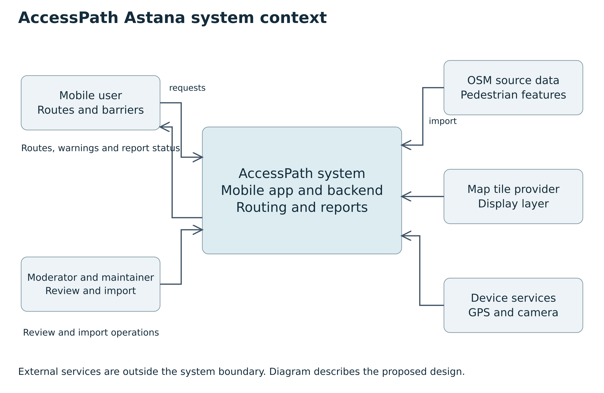
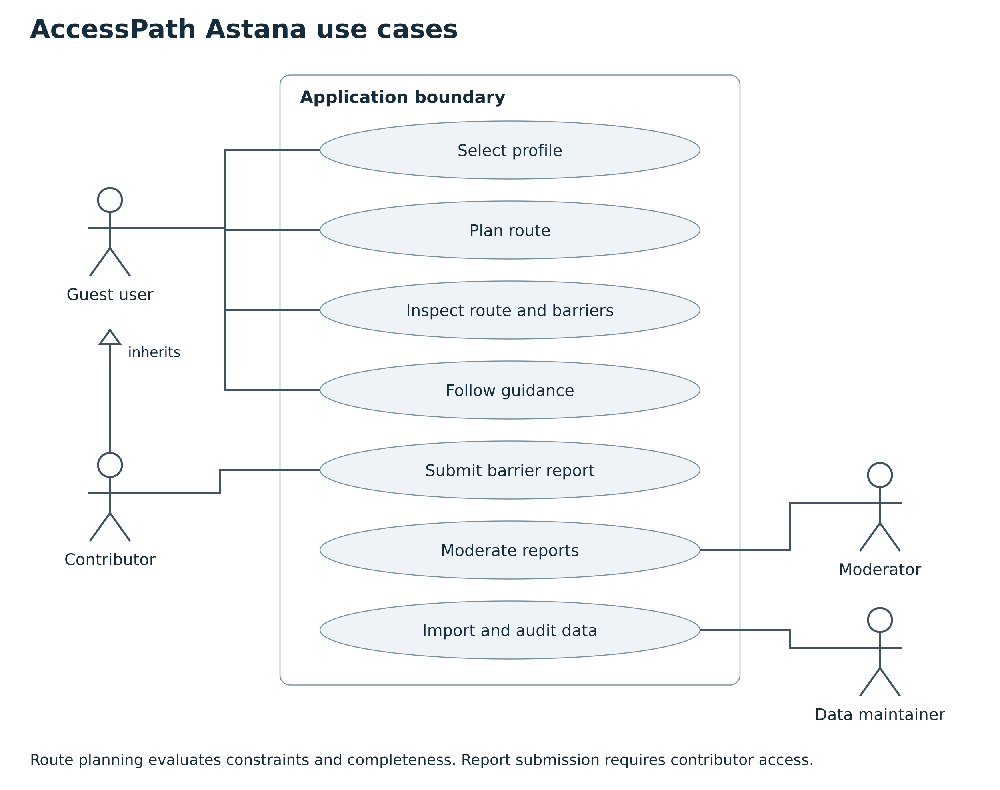
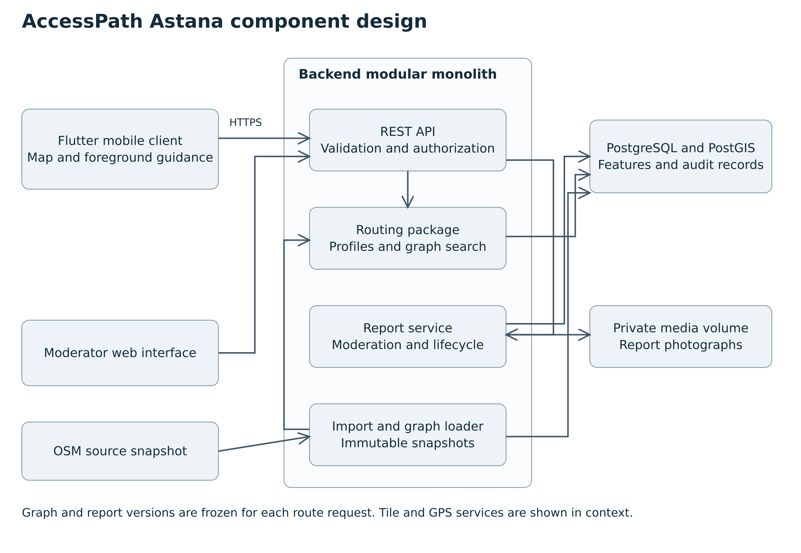

## 7 Architecture and diagrams

### 7.1 System context

The mobile user selects constraints and requests routes; the contributor submits evidence; the moderator reviews reports; and the data maintainer imports and audits pedestrian data. External dependencies are the OSM dataset, a tile provider and device location/camera services. The system boundary includes the mobile client, backend, routing package, database, media storage and moderator interface.

### 7.2 Use cases

Guest users can select a profile, plan a route, inspect barriers and use guidance. Contributors inherit these capabilities and can submit reports. Moderators review reports; data maintainers import and inspect data. Route planning always evaluates profile constraints and data completeness. Sending a report does not automatically confirm it.

### 7.3 Component design

The API validates requests and delegates to routing or report services. The graph loader builds immutable snapshots from the database. Moderation commits a report version and triggers a snapshot refresh. Routing returns the graph and report versions used, avoiding mixed versions within one request. The mobile client receives geometry, warnings and instructions through the same contract.

Editable SVG sources and Mermaid or PlantUML text are supplied alongside readable PNG exports. This is a proposed architecture, not an implemented deployment.

### 7.4 Data model and collection

| Entity | Key fields and relationships |
| --- | --- |
| PilotArea | ID, agreed polygon, version, approval date |
| Node | ID, point geometry, source reference, level or crossing context |
| Edge | From/to nodes, geometry, length, direction, slope, surface, width, steps and crossing/kerb references |
| Observation | Feature ID, attribute, value and unit, source, method, observed_at, verification status |
| MobilityProfile | ID/version, hard limits, penalty weights and unknown policy |
| BarrierReport | Contributor, point, candidate edge, type, evidence, timestamps and lifecycle status |
| ModerationAction | Report ID, moderator, previous/new status, reason and timestamp |
| Photo | Report ID, private storage key, media type, size and stripped-metadata status |
| GraphSnapshot | Import version, observations version, report version, build timestamp and checksum |

One report may be associated with multiple candidate edges until reviewed. At crossings, distinguish the two kerbs and travel directions. Crossing lines on a map are not automatically connected: bridge, tunnel, level and crossing information must be inspected. Unknown values remain null with an explicit status; they must not become zeros or 'accessible'.

Import OSM paths and tags, retain provenance and generate a missingness report. Walk a selected audit subset using a consistent form. Record kerb measurements in metres and slope as a directional percentage where measurement is defensible [R13–R14]. Photograph only relevant infrastructure. If equipment cannot measure a feature reliably, mark it unknown. Keep original data and manual observations separately so later imports do not erase verified changes.

### 7.5 Graph and routing model

Use a directed graph G = (V, E). Split edges at junctions and relevant barriers. Origin/destination snapping must respect actual pedestrian connectivity: a nearby path across a fence is not automatically reachable. A failed connection returns a location error rather than an invented crossing.

For profile p, first remove edges violating known hard constraints. In strict mode also remove edges missing any attribute required to establish eligibility for that profile. In exploratory mode permit selected unknown attributes with a nonnegative penalty and explicit warnings. Neither mode overrides a known prohibition.

For remaining edges use C(e,p) = L(e) × [1 + ws(p) × S(e) + wr(p) × R(e) + wu(p) × U(e)] + B(e,p). L is geometric length in metres; S, R and U are normalized nonnegative slope, surface and unknown indicators. Weights are nonnegative. B is a nonnegative barrier penalty in equivalent metres; an impassable barrier is excluded, not merely penalized. This is generalized cost, not travel time. Thresholds and weights will be calibrated using consultation and field fixtures and versioned before evaluation.

A* uses planar straight-line distance to the target in the same local metric coordinate system used for edge lengths. Because edge cost is at least edge length and length is at least endpoint displacement, this heuristic is a lower bound and is consistent. Validate those assumptions during graph construction, including lift connectors. Use h = 0 if they cannot be guaranteed. Dijkstra and A* share eligibility rules, costs, graph snapshot and stopping rules.

Initial preset behaviour: wheelchair and stroller presets exclude known steps; crutch and older-pedestrian presets initially favour step avoidance and can be adjusted before routing. All presets expose distance trade-offs and unknown policy. Numeric slope and kerb limits are configuration values to validate, not medical advice or universal standards. Benchmarks must not mix different preset versions.

### 7.6 Report trust and temporal handling

Reports progress from pending to confirmed or rejected; confirmed reports may become resolved or stale. Only confirmed reports alter eligibility, while pending reports can be displayed as unverified information. A moderator must inspect location, evidence and conflicts before confirmation. Duplicate reports do not create independent votes automatically.

For temporary information, an exploratory confidence indicator may use q(t) = q0 × exp(−age/τ), where q0 reflects evidence class and τ depends on barrier type. This is a proposed prioritization score, not a calibrated probability of safety. It schedules rechecks and affects warnings; it must not automatically reopen a confirmed blocked edge. A stale unresolved closure remains excluded in strict mode until rechecked. Permanent steps and kerbs do not disappear through time decay. Cold-start operation uses moderator review rather than an unvalidated reputation score.

### 7.7 API contract outline

| Endpoint | Contract and outcome |
| --- | --- |
| GET /v1/profiles | Versioned presets and editable settings |
| POST /v1/routes | Origin/destination, profile version, overrides and unknown policy; returns GeoJSON line, instructions, distance, warnings and snapshot IDs |
| GET /v1/barriers | Bounding-box query; returns public barrier details without contributor identity |
| POST /v1/reports | Authenticated multipart report; returns report ID and pending status |
| GET /v1/reports/{id} | Contributor's own report or moderator view |
| PATCH /v1/moderation/reports/{id} | Authorized state change with reason and expected version |
| POST /v1/admin/imports | Authorized import job for a declared polygon and source snapshot |

Use longitude/latitude order for GeoJSON. Validate coordinate ranges, pilot membership and timestamp formats. Distinguish OUTSIDE_PILOT, NO_CONNECTED_EDGE, NO_ROUTE and DATA_INSUFFICIENT. A no-route outcome is not a server crash. Concurrent moderation must reject stale versions instead of silently overwriting another review.
